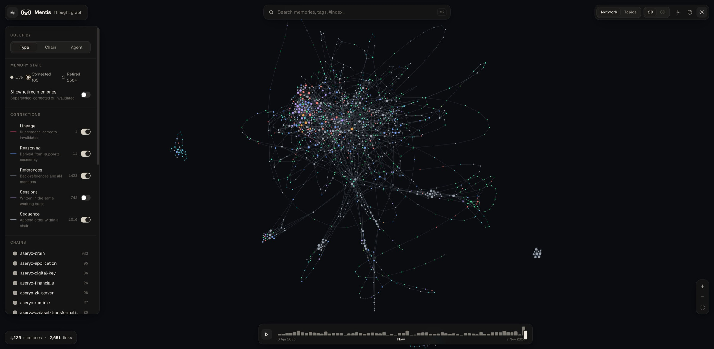

# Mentis Thought Graph

Interactive force-directed viewer for [MentisDB](https://github.com/faulknerpearce) thought chains — a visual map of agent memory: decisions, lessons, corrections, plans, and the relations that bind them.



## What it does

Mentis Graph connects to a local MentisDB daemon over REST and renders every loaded thought as a node in a 2D or 3D force graph. Nodes are coloured by thought type and sized by how connected and important they are.

### Two views

- **Network** (default): one force-directed graph of every thought. Append-order strands, references and relations pull thoughts together, so chains form long threads that knot where they reference each other. Session links are off by default in this view.
- **Topics**: tags and concepts are cleaned into topics (dates, `verified:*` stamps and generic labels such as `checkpoint` are dropped, and `aseryx-` prefixes are merged). Each thought hangs from its most specific topic, and colouring by chain shows which subjects cross repos.

### Connections

| Connection | Meaning |
|------------|---------|
| **Lineage** | `Supersedes`, `Corrects`, `Invalidates`, `Contradicts`: how memory evolved |
| **Reasoning** | `DerivedFrom`, `Supports`, `CausedBy`, `Summarizes`, …: typed links between ideas |
| **References** | Back-references, plus `#N` mentions written in a thought's text, drawn dashed. Each pair is drawn once |
| **Sessions** | Thoughts by the same agent on the same chain written within 45 minutes of each other, drawn dotted |
| **Sequence** | Append order within a chain, bridged over hidden thoughts so strands stay continuous |

In the topic map, references are drawn but do not pull on the layout: there are thousands of them, and they would collapse every topic cluster into one hairball.

### Memory state and versions

Version state comes from MentisDB (`version_status`, `current_version`): thoughts are *live*, *contested* (amber ring) or *retired* (dashed outline). Retired thoughts are hidden by default, as MentisDB hides them from search:

- A memory that replaced earlier versions shows offset rings behind it, and its history is listed in the inspector.
- Links that pointed at an old version are moved to the current version, so no connection is lost.
- Bulk cleanups that retire many thoughts at once count as archive events, not new versions.

Turn on **Show retired memories** to see the full history.

## Features

- **Color by** thought type, chain or agent, with a distinct colour per type in light and dark themes
- **Timeline**: scrub or replay how the network grew
- **Search** (⌘K): highlights matches; Enter jumps to a result
- **Inspector**: markdown content, importance and confidence, earlier versions, and connections grouped by relation (for example "Superseded by"). Clicking a topic lists its memories and the chains it spans
- **Labels** (`#index · type`) appear once you zoom in; a selected thought also shows its title
- **2D + 3D modes**, light and dark themes, safe markdown rendering

## Prerequisites

1. **MentisDB daemon** running locally with REST on `http://127.0.0.1:9472`
2. **Node.js** 20+ (npm)

Verify MentisDB:

```bash
curl -s http://127.0.0.1:9472/health
# {"service":"mentisdb","status":"ok"}
```

Chain data is read from MentisDB storage (default `~/.cloudllm/mentisdb/`) via REST — this app never opens `.tcbin` files directly.

## Run locally

```bash
cd mentis_graph
npm install
npm run dev
```

Open [http://localhost:5173](http://localhost:5173).

Vite proxies `/api/*` → `http://127.0.0.1:9472/*` so the browser avoids CORS. The same proxy applies to `npm run preview`.

## Usage

- **View** (top right): switch between **Network** and **Topics**, and between 2D and 3D.
- **Filters** (left): color mode, memory state, connection types, chains and type families. Hover a row and click **only** to isolate it.
- **Click a node** to open the inspector and light up its neighbourhood. Click a topic to see its memories. Esc closes either.
- **Zoom in** to read labels: topic names appear first, then each thought's index and type.
- **Timeline** (bottom): drag to show memory as it stood on a date, or press play.

First load with many chains can take a moment while thoughts are traversed from MentisDB.

## Scripts

| Command | Description |
|---------|-------------|
| `npm run dev` | Dev server (port 5173) |
| `npm run build` | Typecheck + production build |
| `npm run preview` | Preview production build (with MentisDB proxy) |
| `npm test` | Run unit tests (Vitest) |
| `npm run lint` | Lint with oxlint |

## Stack

- **App:** Vite + React 19 + TypeScript
- **Graph:** [`react-force-graph-2d`](https://github.com/vasturiano/react-force-graph) / [`react-force-graph-3d`](https://github.com/vasturiano/react-force-graph) + `d3-force-3d`
- **Content:** `react-markdown` + `remark-gfm`
- **Data:** MentisDB REST (`/v1/chains`, `/v1/thoughts/traverse`)
